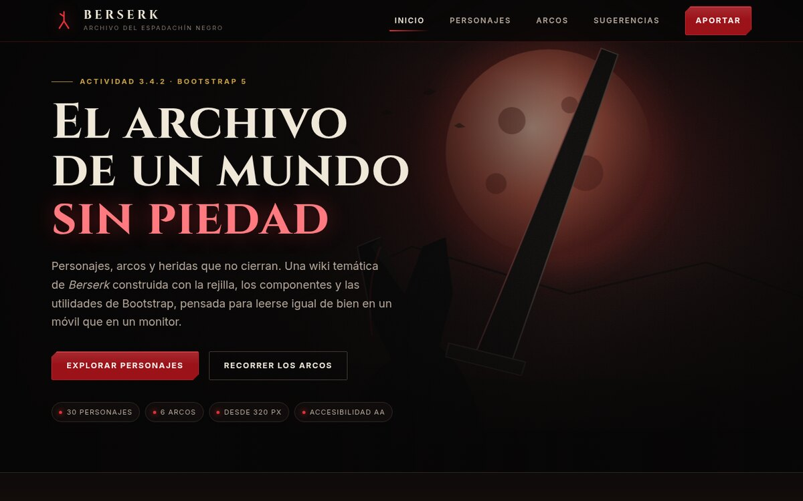
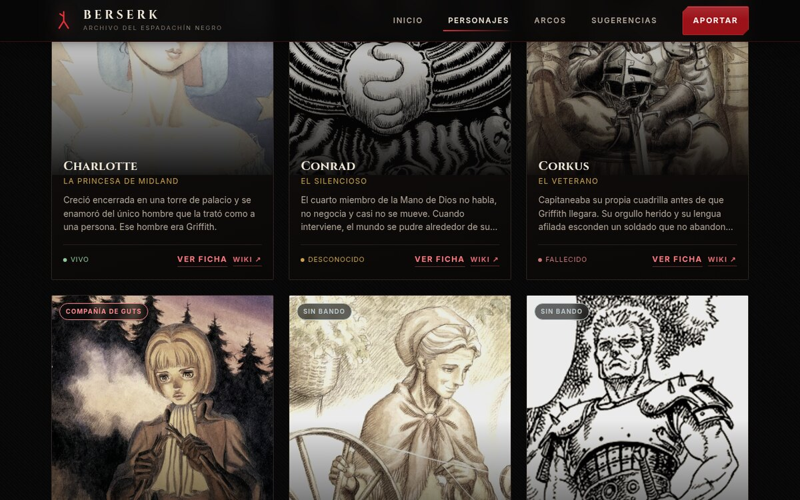
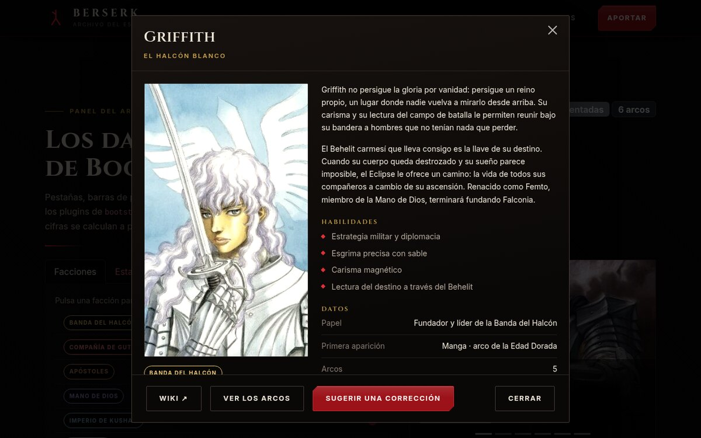
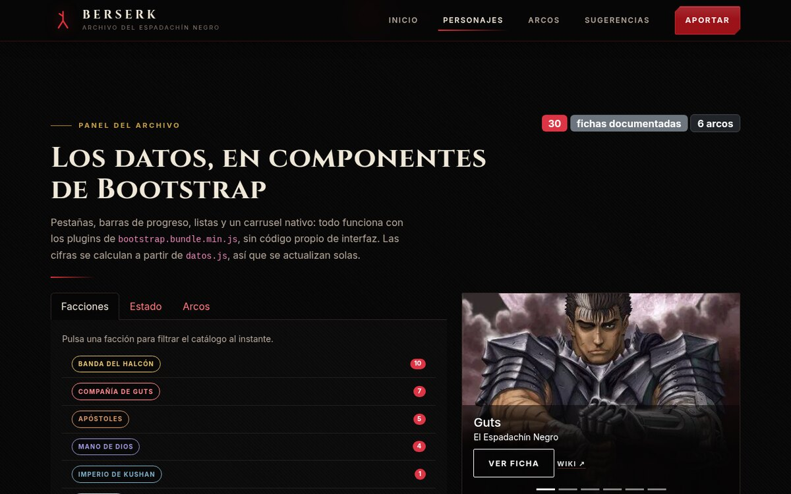
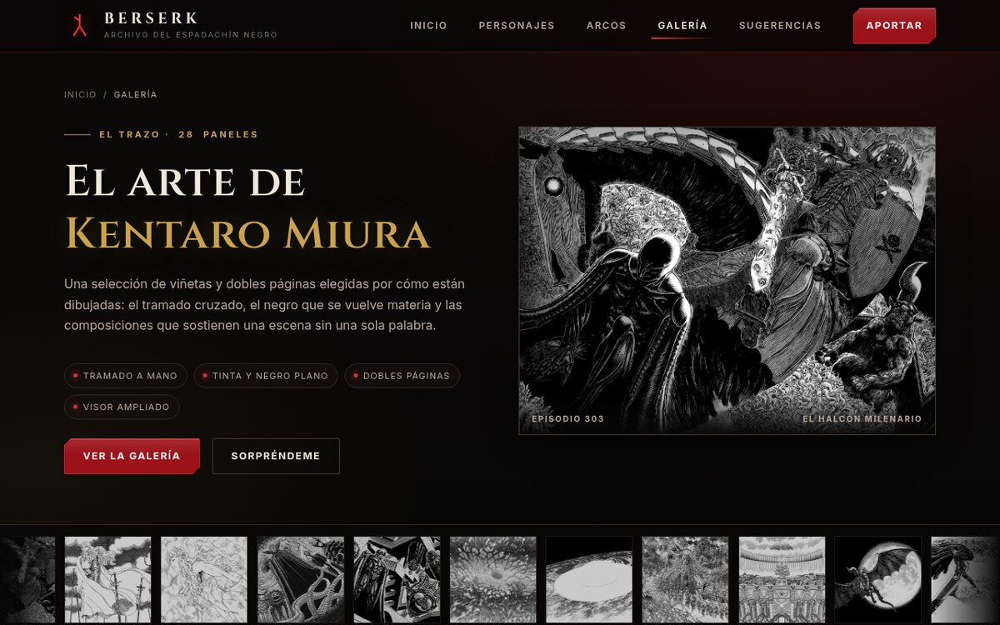
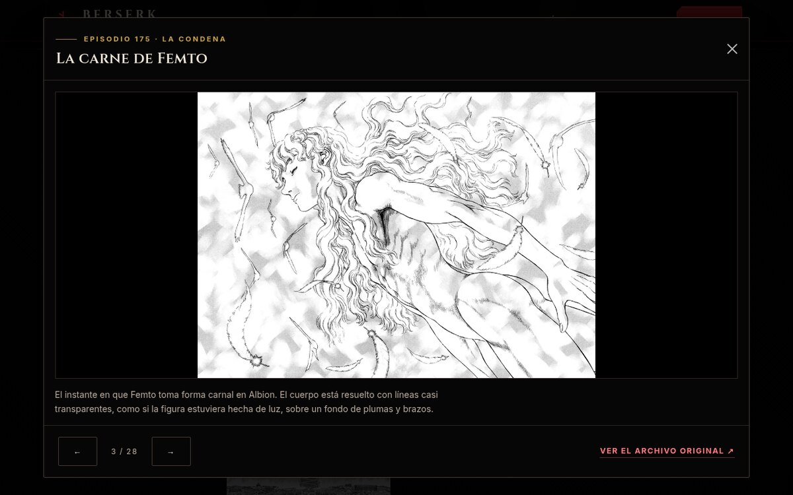
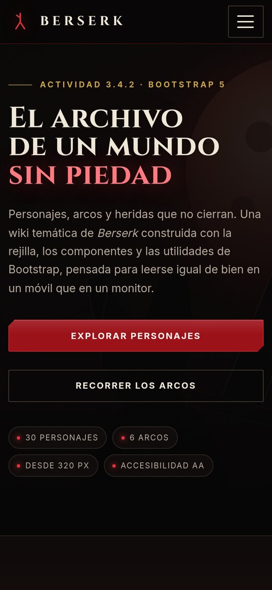
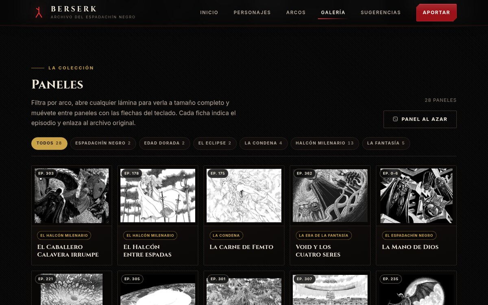

<div align="center">



**Wiki temática de _Berserk_** — 30 fichas de personajes, seis arcos y **28 paneles del manga**
elegidos por su dibujo, en un catálogo que se filtra, se ordena y se lee igual de bien en un móvil
que en un monitor.


-E0B06A?style=flat-square&labelColor=070606)




</div>

**Archivo del Espadachín Negro** es una wiki de _Berserk_ construida como entrega de la actividad
**3.4.2** de maquetación web: un sitio **estático**, **sin compilación** y **sin dependencias que
instalar**, donde todo el peso de la interfaz lo lleva **Bootstrap 5.3.3** vendorizado.

La idea era demostrar que se puede montar un archivo temático completo —catálogo, fichas, cronología
y formulario— usando la rejilla, las utilidades y los componentes de Bootstrap, con una capa de CSS
propia que solo aporta el tema visual, y un único archivo de datos que alimenta todas las vistas.

<div align="center">

| 📚 **30 fichas** | 🕰️ **6 arcos** | 🖼️ **28 paneles** | 📦 **0 dependencias** |
| :--: | :--: | :--: | :--: |
| Retrato, historia, habilidades y arcos | Del Espadachín Negro a la Era de la Fantasía | Galería con visor y filtros por arco | Solo el bundle de Bootstrap, servido en local |
| *Un archivo `datos.js` los alimenta* | *Cronología con fichas en modal* | *Un archivo `paneles.js` los ordena* | *Abre con doble clic* |

</div>

---

<a id="indice"></a>
## 📌 Índice

<div align="center">

|  |  |
| :--: | :--: |
| 🌑 [Acerca del proyecto](#acerca) | 📸 [Vista previa](#vista-previa) |
| ✨ [Qué incluye](#incluye) | 🖼️ [Galería de paneles](#galeria) |
| 🧩 [Bootstrap en uso](#bootstrap) | 🗂️ [El archivo en datos](#datos) |
| 🛠️ [Stack tecnológico](#stack) | 📂 [Estructura](#estructura) |
| ⚡ [Ejecutar en local](#local) | 🚀 [Despliegue](#despliegue) |
| ♿ [Accesibilidad](#accesibilidad) | 🧭 [Roadmap](#roadmap) |
| 👤 [Autor](#autor) | 📄 [Créditos](#creditos) |

</div>

---

<a id="acerca"></a>
## 🌑 Acerca del proyecto

> _«No hay paraíso para quien lleva la marca.»_ El archivo no suaviza la obra: cuenta el Eclipse,
> la caída de Griffith y el destino de media Banda del Halcón **sin rodeos**, con avisos de spoiler
> en las fichas que destripan giros importantes.

El sitio se organiza en cuatro páginas y un archivo de datos:

| Página | Qué resuelve |
|---|---|
| 🏛️ `index.html` | Portada, cifras del archivo, tres personajes destacados y ficha técnica del proyecto |
| 🃏 `personajes.html` | Catálogo completo con búsqueda, filtros, orden, paginación, ficha en modal, panel de componentes y tabla comparativa |
| 🕰️ `arcos.html` | Cronología de los seis arcos con ficha ampliada de cada uno en modal |
| ✍️ `sugerencias.html` | Formulario de captura con ocho campos, validación en vivo y resumen en modal de confirmación |

Todo lo demás —personajes, facciones, estados y arcos— vive en **`assets/js/datos.js`**. Añadir un
personaje significa editar ese archivo: las tarjetas, la tabla, los filtros, los modales, el carrusel
y las cifras del panel se actualizan solos.

<div align="center">

</div>

<a id="vista-previa"></a>
## 📸 Vista previa

<div align="center">

| Portada | Catálogo de personajes |
| :--: | :--: |
|  |  |
| **Hero a pantalla completa** con la marca y las cifras del archivo | **Rejilla responsive** de 1 a 4 columnas con insignias y estado |

| Ficha ampliada en modal | Panel de componentes Bootstrap |
| :--: | :--: |
|  |  |
| **Retrato, descripción, habilidades y arcos** enlazados | **Pestañas, barras, listas y carrusel** alimentados por `datos.js` |

| Galería de paneles | Visor ampliado |
| :--: | :--: |
|  |  |
| **Lámina de apertura** con zoom lento y cinta de miniaturas | **Doble página completa** con anterior, siguiente y fuente |



**Vista móvil (390 px)** — menú colapsable, tipografía fluida y áreas táctiles de 40 px o más.

</div>

---

<a id="incluye"></a>
## ✨ Qué incluye

### 📚 Archivo de 30 fichas

Cada personaje tiene retrato, epíteto, facción, estado, primera aparición, rol, resumen para la
tarjeta, dos párrafos de historia, lista de habilidades, arcos en los que aparece y **enlace a su
artículo original**. Una ficha puede pertenecer a dos facciones: Guts y Casca son Banda del Halcón
y también Compañía de Guts.

### 🔎 Búsqueda, filtros, orden y paginación

| Control | Comportamiento |
|---|---|
| 🔍 **Buscar** | Filtra por nombre, epíteto, rol o resumen; ignora tildes y mayúsculas y aplica *debounce* de 180 ms |
| 🏷️ **Facción** | Seis facciones, generadas desde `datos.js` |
| 💀 **Estado** | Vivo, fallecido o desconocido, con insignia de color |
| ↕️ **Orden** | Nombre A–Z, Z–A, facción o estado |
| 📄 **Paginación** | Doce fichas por página con salto suave al principio de los resultados |
| 🧹 **Limpiar** | Restablece todos los filtros de una vez |

El estado vacío tiene su propio bloque con un botón para quitar los filtros, y el contador
«Mostrando 1–12 de 30 personajes» se anuncia por `aria-live`.

### 🃏 Ficha ampliada en modal

Al pulsar **Ver ficha** (en la tarjeta, en la tabla, en el carrusel o desde un enlace directo) se
abre un modal de Bootstrap con el retrato, las facciones, el estado, la historia completa, las
habilidades, los arcos —enlazados a su cronología— y un enlace externo a la fuente. Las fichas con
spoilers muestran un aviso rojo antes del texto.

También hay enlaces directos compartibles:

```
personajes.html?personaje=guts
personajes.html#slan
```

### 🧩 Panel de componentes Bootstrap

La sección `#radiografia` de `personajes.html` es una demostración en vivo: **pestañas** que cambian
de panel, **listas** con contadores, **barras de progreso** por estado, **carrusel** de retratos con
indicadores, **acordeón** de preguntas frecuentes y un **toast** que confirma cada filtro aplicado.
Ninguno lleva JavaScript propio de interfaz: todos son plugins del bundle.

### 🕰️ Cronología de arcos

Seis arcos con número, tomos, resumen, detalle, personajes implicados y su propio modal. Las fichas
de personaje enlazan al arco concreto (`arcos.html#eclipse`).

### ✍️ Formulario validado

Ocho campos con validación en vivo, ayudas asociadas por `aria-describedby`, contador de caracteres,
resumen en modal antes de enviar y foco automático en el primer campo inválido.

### 🔗 Enlaces a la fuente

Cada ficha apunta a [Berserk Wiki](https://berserk.fandom.com/wiki/Berserk_Wiki) con
`target="_blank"` y `rel="noopener noreferrer"`. Esos enlaces aparecen en la tarjeta, en el modal,
en el carrusel, en el bloque de fuentes externas y en el pie de las cinco páginas.

### 🖼️ Galería de 28 paneles

Una página aparte dedicada solo al dibujo: viñetas y dobles páginas de Kentaro Miura con filtros por
arco, rejilla de tarjetas iguales, visor ampliado y enlaces directos. Se detalla más abajo, en
[Galería de paneles](#galeria).

---

<a id="galeria"></a>
## 🖼️ Galería de paneles

`galeria.html` es una sección aparte, dedicada únicamente al dibujo. Reúne **28 viñetas y dobles
páginas** del manga elegidas por su tramado, su composición y su uso del negro, cada una con su
episodio, su arco y un comentario breve sobre cómo está resuelta.

<div align="center">

| Portada de la galería | Rejilla filtrada por arcos |
| :--: | :--: |
|  |  |
| **Lámina de apertura** con zoom lento y cinta de miniaturas | **Tarjetas pequeñas de 6 → 1 columnas** con filtros y contador en vivo |


**Visor ampliado** — doble página a tamaño completo, navegación anterior/siguiente, contador y
enlace al archivo original de la wiki.

</div>

### 🧱 Cómo está montada

| Pieza | Comportamiento |
|---|---|
| 🗃️ **Datos** | `assets/js/paneles.js` guarda los 28 paneles: id, título, episodio, arco, medidas, texto alternativo, comentario y fuente |
| 🏷️ **Filtros** | Un botón por arco con su recuento; «Todos» vuelve a la colección completa y el estado vacío ofrece limpiar el filtro |
| 🧱 **Rejilla uniforme** | `grid` de 6 a 1 columnas; tarjetas pequeñas e idénticas (marco 4:3 con margen interior) y el panel entra completo, sin recortes |
| 🔍 **Visor** | Modal de Bootstrap con la imagen a tamaño completo, anterior y siguiente, contador `n / 28` y enlace al archivo de origen |
| ⌨️ **Teclado** | `←` y `→` cambian de panel con el visor abierto; `Esc` lo cierra; el foco queda atrapado en el modal |
| 🔗 **Enlace directo** | `galeria.html?panel=eclipse` abre esa lámina al cargar; al cerrar, la URL se limpia sola |
| 🎲 **Panel al azar** | Dos botones —portada y rejilla— eligen una lámina al azar dentro del filtro activo |
| 🎞️ **Animaciones** | Zoom lento tipo *Ken Burns* en la apertura, cinta de miniaturas en bucle, aparición al hacer scroll y zoom al pasar el ratón |
| 🛑 **Sin movimiento** | Todo lo anterior se desactiva con `prefers-reduced-motion: reduce`; el contenido queda visible y estático |

### 🗂️ Reparto por arco

| Arco | Paneles |
| :-- | :--: |
| El Espadachín Negro | 2 |
| La Edad Dorada | 2 |
| El Eclipse | 2 |
| La Condena | 4 |
| El Halcón Milenario | 13 |
| La Era de la Fantasía | 5 |
| **Total** | **28** |

Las imágenes se sirven en WebP a 1100 px (versión completa) y 520 px (miniatura `-min`), con
`srcset` y `sizes` para que el navegador elija. El conjunto pesa unos 7,6 MB, y las miniaturas se
cargan con `loading="lazy"`.

> **Derechos.** Los paneles pertenecen a **Kentaro Miura** y a **Hakusensha**. Se muestran con fines
> educativos y de comentario, citando el episodio y el archivo de origen en
> [Berserk Wiki](https://berserk.fandom.com/wiki/Berserk_Wiki). Este proyecto no reclama licencia
> alguna sobre las imágenes.

---

<a id="bootstrap"></a>
## 🧩 Bootstrap en uso

| Componente | Dónde se ve | Clases principales |
|---|---|---|
| Rejilla de 12 columnas | Todas las páginas | `container` · `row` · `col-12 col-sm-6 col-lg-4 col-xxl-3` |
| Navbar colapsable | Cabecera fija | `navbar` · `navbar-expand-lg` · `navbar-toggler` · `collapse` |
| Pestañas | Panel del archivo | `nav-tabs` · `tab-content` · `tab-pane` · `data-bs-toggle="tab"` |
| Carrusel | Panel del archivo | `carousel` · `carousel-indicators` · `carousel-caption` |
| Acordeón | Panel del archivo | `accordion` · `accordion-collapse` · `data-bs-parent` |
| Listas | Facciones y fuentes | `list-group` · `list-group-item-action` |
| Barras de progreso | Estado de las fichas | `progress` · `progress-bar` · `bg-success` |
| Modales | Fichas de personaje, arcos y visor de paneles | `modal` · `modal-dialog-scrollable` · `btn-close` |
| Tarjetas | Catálogo y portada | `card` propio + utilidades `d-flex` · `gap-*` · `h-100` |
| Tabla responsive | Comparativa del archivo | `table` · `table-striped` · `table-hover` · `table-responsive` |
| Formularios | Búsqueda y sugerencias | `form-control` · `form-select` · `form-label` · `is-invalid` |
| Paginación y migas | Catálogo y cabeceras | `pagination` · `page-link` · `breadcrumb` |
| Avisos flotantes | Filtros del catálogo | `toast` · `toast-container` · `position-fixed` |
| Insignias | Estados y facciones | `badge` · `text-bg-danger` · `rounded-pill` |

Utilidades usadas a fondo: `d-flex`, `flex-wrap`, `justify-content-between`, `align-items-center`,
`gap-*`, `gy-*`, `visually-hidden`, `text-lg-end`, `text-secondary-emphasis`, `border-secondary-subtle`
y el tema oscuro nativo con `data-bs-theme="dark"`.

---

<a id="datos"></a>
## 🗂️ El archivo en datos

<div align="center">

| Facción | Fichas | Estado | Fichas |
| :-- | :--: | :-- | :--: |
| 🦅 Banda del Halcón | 10 | 🟢 Vivo | 18 |
| 🗡️ Compañía de Guts | 7 | 🔴 Fallecido | 7 |
| 👹 Apóstoles | 5 | ⚪ Desconocido | 5 |
| 👁️ Mano de Dios | 4 | | |
| 🐘 Imperio de Kushan | 1 | | |
| ⚔️ Sin bando | 5 | | |

</div>

<details>
<summary><strong>📋 Ver las 30 fichas</strong></summary>

<br/>

| Personaje | Epíteto | Facción | Estado | Arcos | Fuente |
|:--|:--|:--|:--:|:--:|:--|
| **Azan** | El Caballero de la Cadena de Hierro | Sin bando | Vivo | 3 | [Wiki](https://berserk.fandom.com/wiki/Azan) |
| **Caballero Calavera** | El Espectro del Abismo | Sin bando | Desconocido | 5 | [Wiki](https://berserk.fandom.com/wiki/Skull_Knight) |
| **Casca** | La Capitana de la Banda | Banda del Halcón | Vivo | 5 | [Wiki](https://berserk.fandom.com/wiki/Casca) |
| **Charlotte** | La Princesa de Midland | Banda del Halcón | Vivo | 3 | [Wiki](https://berserk.fandom.com/wiki/Charlotte) |
| **Conrad** | El Silencioso | Mano de Dios | Desconocido | 1 | [Wiki](https://berserk.fandom.com/wiki/Conrad) |
| **Corkus** | El Veterano | Banda del Halcón | Fallecido | 2 | [Wiki](https://berserk.fandom.com/wiki/Corkus) |
| **Farnese** | La Cazadora de Brujas | Compañía de Guts | Vivo | 3 | [Wiki](https://berserk.fandom.com/wiki/Farnese) |
| **Flora** | La Señora del Bosque | Sin bando | Fallecido | 2 | [Wiki](https://berserk.fandom.com/wiki/Flora) |
| **Gambino** | El Capitán Quebrado | Sin bando | Fallecido | 2 | [Wiki](https://berserk.fandom.com/wiki/Gambino) |
| **Ganishka** | El Emperador que Quiso Ser Dios | Imperio de Kushan | Fallecido | 1 | [Wiki](https://berserk.fandom.com/wiki/Ganishka) |
| **Griffith** | El Halcón Blanco | Banda del Halcón | Vivo | 5 | [Wiki](https://berserk.fandom.com/wiki/Griffith) |
| **Grunbeld** | El Dragón de Fuego | Apóstoles | Vivo | 2 | [Wiki](https://berserk.fandom.com/wiki/Grunbeld) |
| **Guts** | El Espadachín Negro | Compañía de Guts | Vivo | 6 | [Wiki](https://berserk.fandom.com/wiki/Guts) |
| **Irvine** | El Arquero de la Noche | Apóstoles | Vivo | 2 | [Wiki](https://berserk.fandom.com/wiki/Irvine) |
| **Isidro** | El Ladrón | Compañía de Guts | Vivo | 3 | [Wiki](https://berserk.fandom.com/wiki/Isidro) |
| **Judeau** | El de los Cuchillos | Banda del Halcón | Fallecido | 2 | [Wiki](https://berserk.fandom.com/wiki/Judeau) |
| **Locus** | El Caballero de la Luna | Apóstoles | Vivo | 2 | [Wiki](https://berserk.fandom.com/wiki/Locus) |
| **Luca** | La Que Sostiene a las Demás | Sin bando | Vivo | 1 | [Wiki](https://berserk.fandom.com/wiki/Luca) |
| **Mule Wolflame** | El Soldado que Creyó | Banda del Halcón | Vivo | 2 | [Wiki](https://berserk.fandom.com/wiki/Mule) |
| **Nosferatu Zodd** | La Bestia Inmortal | Apóstoles | Vivo | 4 | [Wiki](https://berserk.fandom.com/wiki/Nosferatu_Zodd) |
| **Pippin** | El Muro | Banda del Halcón | Fallecido | 2 | [Wiki](https://berserk.fandom.com/wiki/Pippin) |
| **Puck** | El Elfo Sanador | Compañía de Guts | Vivo | 4 | [Wiki](https://berserk.fandom.com/wiki/Puck) |
| **Rickert** | El Aprendiz | Banda del Halcón | Vivo | 3 | [Wiki](https://berserk.fandom.com/wiki/Rickert) |
| **Schierke** | La Bruja de Elfhelm | Compañía de Guts | Vivo | 3 | [Wiki](https://berserk.fandom.com/wiki/Schierke) |
| **Serpico** | El Caballero del Viento | Compañía de Guts | Vivo | 3 | [Wiki](https://berserk.fandom.com/wiki/Serpico) |
| **Slan** | La Princesa del Mar Uterino | Mano de Dios | Desconocido | 2 | [Wiki](https://berserk.fandom.com/wiki/Slan) |
| **Sonia** | La Vidente de Falconia | Banda del Halcón | Vivo | 2 | [Wiki](https://berserk.fandom.com/wiki/Sonia) |
| **Ubik** | El Orador | Mano de Dios | Desconocido | 2 | [Wiki](https://berserk.fandom.com/wiki/Ubik) |
| **Void** | El Cerebro de la Mano de Dios | Mano de Dios | Desconocido | 3 | [Wiki](https://berserk.fandom.com/wiki/Void) |
| **Wyald** | La Bestia de la Banda Negra | Apóstoles | Fallecido | 1 | [Wiki](https://berserk.fandom.com/wiki/Wyald) |

</details>

---

<a id="stack"></a>
## 🛠️ Stack tecnológico

<div align="center">

| Capa | Tecnología | Detalle |
| :-- | :-- | :-- |
| Estructura | **HTML5 semántico** | `main`, `section`, `article`, `nav`, `footer`, encabezados sin saltos |
| Estilos | **CSS3** | 18 bloques comentados, variables `--emi-*`, `clamp()`, `aspect-ratio`, `grid`, `prefers-reduced-motion` |
| Interfaz | **Bootstrap 5.3.3** | CSS y bundle JS vendorizados en `assets/vendor/` |
| Lógica | **JavaScript ES6** | Siete módulos IIFE, sin transpilación ni bundler |
| Datos | **`datos.js` + `paneles.js`** | `window.BERSERK` con personajes, facciones, estados y arcos; `window.PANELES` con la galería |
| Tipografía | **Cinzel + Inter** | Google Fonts con `preconnect` y familias de reserva |
| Gráficos | **SVG propio** | Emblemas, portada y logotipo generados con `tools/generar_arte.py` |
| Despliegue | **Vercel** + **GitHub Pages** | Estático, sin build ni funciones |

</div>

---

<a id="estructura"></a>
## 📂 Estructura del proyecto

```text
.
├── index.html                    Portada, cifras, destacados y ficha técnica
├── personajes.html               Catálogo, panel de componentes y tabla comparativa
├── arcos.html                    Cronología y fichas de arcos en modal
├── galeria.html                  Galería de paneles: filtros, rejilla y visor
├── sugerencias.html              Formulario validado + preguntas frecuentes
├── vercel.json                   Cabeceras de caché, seguridad y redirecciones
│
├── assets/
│   ├── css/
│   │   └── estilos.css           Tema completo, comentado por secciones
│   ├── js/
│   │   ├── datos.js              Personajes, facciones y arcos (fuente única)
│   │   ├── comun.js              Navegación, año y animaciones de entrada
│   │   ├── catalogo.js           Filtros, tarjetas, paginación, ficha y panel
│   │   ├── arcos.js              Modal de arcos
│   │   ├── paneles.js            Los 28 paneles de la galería (fuente única)
│   │   ├── galeria.js            Filtros, rejilla, visor y enlace directo
│   │   └── formulario.js         Validación, contador y confirmación
│   ├── img/
│   │   ├── personajes/           30 retratos (400 px de ancho)
│   │   ├── arcos/                Emblemas vectoriales de los seis arcos
│   │   ├── paneles/              28 paneles en WebP + 28 miniaturas `-min`
│   │   ├── heroe.svg             Escena de portada
│   │   ├── marca-sacrificio.svg  Marca de sacrificio
│   │   └── favicon.svg
│   ├── readme/                   Banner, separador y capturas de este README
│   └── vendor/                   Bootstrap 5.3.3 (CSS y bundle JS)
│
└── tools/
    └── generar_arte.py           Genera emblemas, portada y logotipo en SVG
```

---

<a id="local"></a>
## ⚡ Ejecutar en local

No hay `npm install`, ni `composer`, ni paso de compilación. Bootstrap, los estilos y las imágenes
viven en el propio repositorio: el sitio funciona incluso **sin conexión** (solo las tipografías se
piden a Google Fonts y, si no hay red, el navegador usa las familias de reserva).

```bash
git clone https://github.com/luis06-op/berserk-guts-web.git
cd berserk-guts-web
```

**Opción 1 — abrir el archivo**

```bash
xdg-open index.html      # Linux
open index.html          # macOS
start index.html         # Windows
```

**Opción 2 — servidor local (recomendada)**

```bash
python3 -m http.server 8123
# http://127.0.0.1:8123/
```

```bash
php -S 127.0.0.1:8123 -t .     # alternativa con PHP
```

> Los enlaces directos `personajes.html?personaje=guts` y `personajes.html#slan` funcionan en ambos
> casos, porque los resuelve JavaScript al cargar la página.

---

<a id="despliegue"></a>
## 🚀 Despliegue

El proyecto es 100 % estático: cualquier hosting que sirva archivos lo publica tal cual.

### ▲ Vercel (producción)

**Producción:** https://berserk-guts-web.vercel.app

Al importar el repositorio desde el panel de Vercel basta con dejar el *framework preset* en
**Other**, sin comando de build y con la raíz como directorio de salida. Cada `push` a `main`
despliega automáticamente.

```bash
# Despliegue manual con la CLI
npm i -g vercel
vercel login
vercel --prod
```

`vercel.json` añade tres cosas:

| Ajuste | Para qué |
|---|---|
| **Cabeceras de caché** | Un año para `assets/vendor/` (versión fija); CSS, JS, imágenes y HTML se revalidan en cada visita |
| **Cabeceras de seguridad** | `nosniff`, `SAMEORIGIN`, `Referrer-Policy` y `Permissions-Policy` |
| **Redirecciones** | Atajos legibles que llevan a las páginas y fichas |

| Ruta corta | Destino |
| :-- | :-- |
| `/inicio` | `/` |
| `/fichas` | `/personajes.html` |
| `/galeria` | `/galeria.html` |
| `/paneles` | `/galeria.html` |
| `/personaje/guts` | `/personajes.html?personaje=guts` |

### 🐙 GitHub Pages (espejo)

**Espejo:** https://luis06-op.github.io/berserk-guts-web/

El repositorio publica `main` en la raíz mediante Pages. Es el destino que se usa para comparar el
comportamiento del sitio sin las redirecciones de Vercel.

---

<a id="accesibilidad"></a>
## ♿ Accesibilidad

- Enlace **«Saltar al contenido»** y jerarquía de encabezados sin saltos.
- Formularios con `<label>` asociado, ayudas por `aria-describedby` y errores anunciados con `aria-live`.
- Modales de Bootstrap con foco atrapado, cierre por teclado y `aria-modal`.
- Visor de la galería con `←`/`→` para cambiar de panel, contador anunciado y enlace directo por URL.
- Resultados del catálogo, filtros y recuento de paneles anunciados con `role="status"`.
- Imágenes con texto alternativo; decorativas con `aria-hidden`.
- Áreas táctiles de 40 px o más y foco visible con anillo dorado.
- Animaciones desactivadas cuando el sistema pide `prefers-reduced-motion`.
- Contraste revisado a mano sobre fondo `#070606`.

---

<a id="roadmap"></a>
## 🧭 Roadmap

- [x] Catálogo con búsqueda, filtros, orden y paginación
- [x] Fichas de personaje en modal con enlace directo
- [x] Cronología de arcos y fichas de arco
- [x] Formulario validado con resumen
- [x] Panel de componentes Bootstrap con datos en vivo
- [x] Enlaces externos a la fuente de cada ficha
- [x] Galería de 28 paneles con filtros, visor y enlaces directos
- [x] Despliegue en Vercel y GitHub Pages
- [ ] Buscar sin JavaScript con página de resultados precargada
- [ ] Modo claro con `data-bs-theme="light"`
- [ ] Exportar el archivo a PDF con hoja de estilos de impresión

---

<a id="autor"></a>
## 👤 Autor

<div align="center">

**Luis Ángel Muñoz**

Actividad **3.4.2** · Maquetación web con Bootstrap

[](https://github.com/luis06-op)
[](https://github.com/luis06-op/berserk-guts-web)
[](https://berserk-guts-web.vercel.app)

</div>

---

<a id="creditos"></a>
## 📄 Créditos y licencia

Proyecto **educativo y sin ánimo de lucro**, sin afiliación con los titulares de la obra.

- **_Berserk_** es una obra de **Kentaro Miura**, continuada por **Studio Gaga** y **Kouji Mori**.
  Personajes e ilustraciones pertenecen a sus autores y se emplean aquí únicamente con fines
  didácticos.
- Los **retratos** y los **paneles de la galería** provienen de la wiki pública
  [berserk.fandom.com](https://berserk.fandom.com/) y **no se redistribuyen con licencia libre**;
  cada ficha y cada panel enlazan a su archivo original. Los paneles se reproducen a resolución
  reducida y en WebP, con fines de comentario y estudio del dibujo.
- Los **emblemas de los arcos**, la **escena de portada**, el **logotipo**, el **favicon**, el
  **banner** y el **separador** son ilustraciones vectoriales originales generadas con
  `tools/generar_arte.py` y a mano.
- **Bootstrap 5.3.3** se distribuye bajo licencia **MIT**.
- El **código** de este repositorio se comparte con fines educativos; no incluye licencia sobre las
  imágenes de terceros.

<div align="center">


### ⚔️ Hecho con tinta, ceniza y doce columnas ⚔️

</div>
